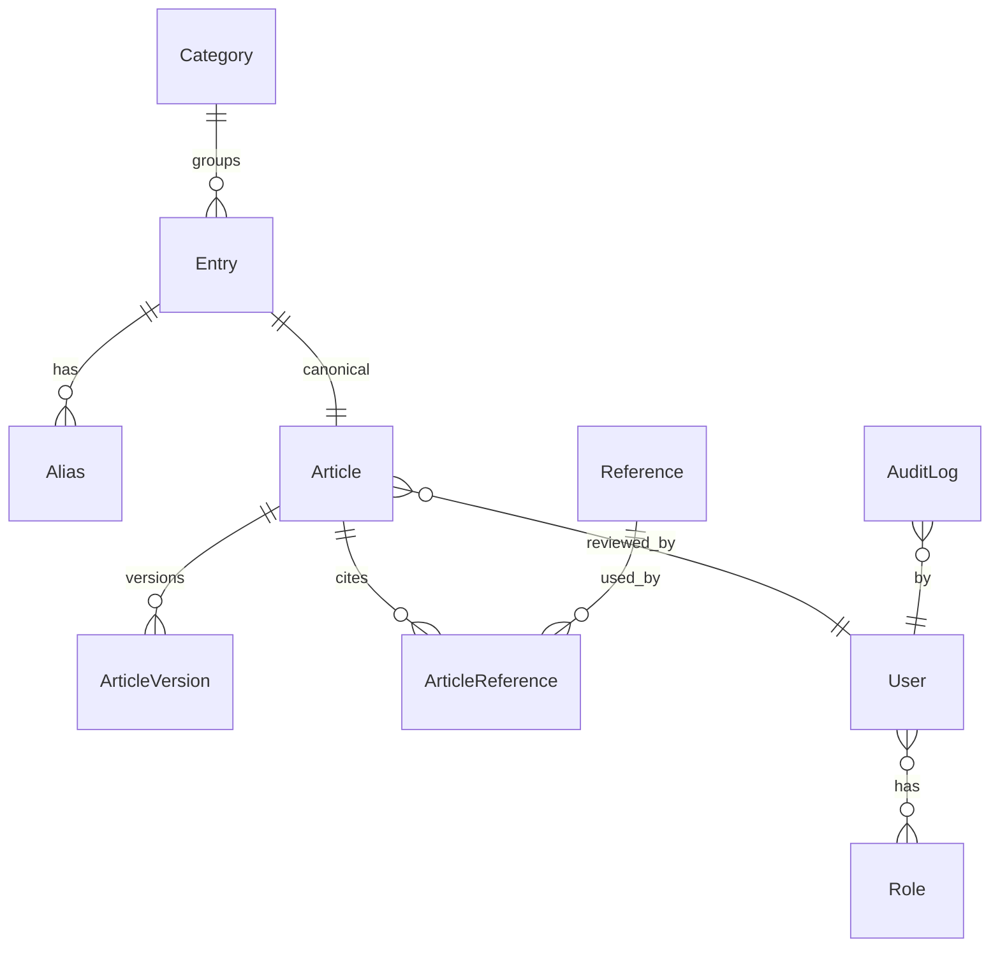

# Database (Phase 0 draft)

Rules: unique slug on Entry, Article, Category; unique normalised text on Alias; FK delete = restrict for Article, cascade for Alias; no whole-content JSON; ArticleVersion is append-only.
